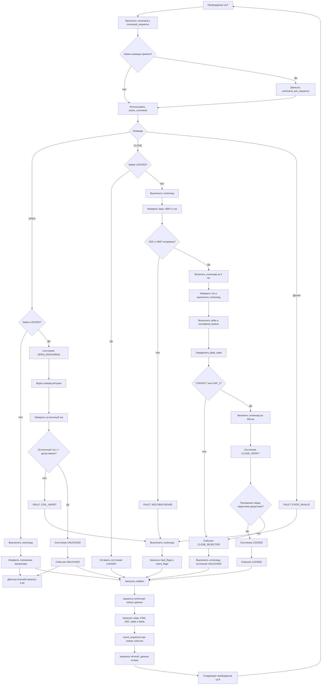

# Блок-схема работы ULP

Диаграмма описывает текущий алгоритм ULP-контроллера соленоида.

## Основные данные mailbox

| Группа | Поля |
|---|---|
| Команда от CPU | `command`, `command_sequence` |
| Подтверждение команды | `command_ack_sequence` |
| Состояние | `lock_state`, `fsm_state`, `plate_state` |
| Измерения | `baseline_raw`, `vbat_raw`, `sense_raw`, `delta_raw`, `normalized_feature` |
| Ошибки | `fault_flags` |
| События | `event_flags`, `event_sequence` |
| Диагностика закрытия | `close_verify_state`, `close_verify_feature`, `close_verify_delta_raw` |
| Счётчики | `measurement_counter`, `close_attempt_counter`, `close_reject_counter` |

`sequence` используется как защита от чтения неполного набора данных: основной процессор принимает snapshot только при одинаковом чётном значении `sequence` до и после чтения.
